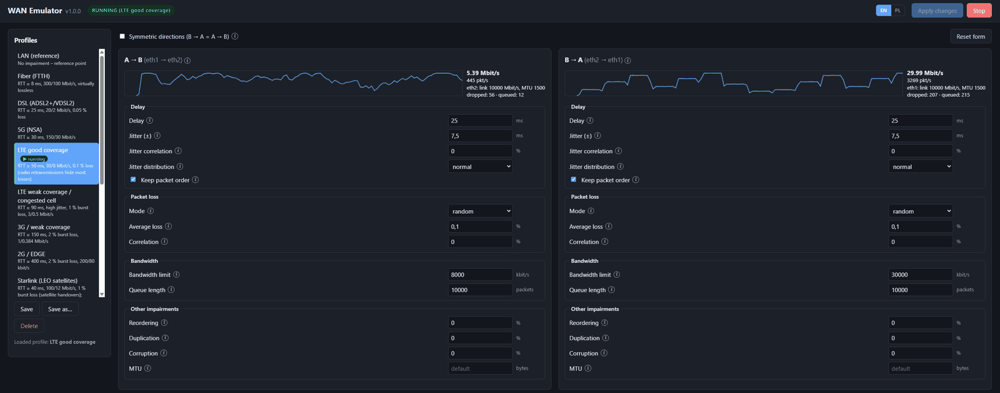

# WAN Emulator

[Polska wersja](README.pl.md)

A WAN link emulator for Linux with a web panel. The host sits between two devices as a transparent bridge and adds delay, jitter, packet loss, bandwidth limits and other impairments, separately for each direction. The emulation is done by the kernel's `tc` / netem; the panel applies the settings, shows live statistics and provides a REST API.



## Features

- Delay and jitter, random or burst packet loss, bandwidth limit, reordering, duplication, corruption, MTU limit
- Separate settings for each direction
- Named profiles, 16 typical links included (DSL, LTE, 3G, Starlink, GEO satellite, VPN, ...)
- Live throughput and drop statistics
- REST API for test automation
- English and Polish UI

## How it works

```
 [Device A] -- eth1 +---------------------------+ eth2 -- [Device B]
                    |  Linux bridge br0 + netem |
                    +-------------+-------------+
                                  | eth0: management (SSH, web panel)
```

- The host works like a two-port switch: devices on both sides are in the same network and need no extra configuration.
- netem shapes outgoing traffic, so **A → B** is applied on `eth2` and **B → A** on `eth1`.
- All traffic crossing the bridge is affected, including ARP.

Interface names and addresses in this README are examples, see [Configuration](#configuration).

## Requirements

- A PC with three Ethernet ports (two bridge ports, one for management)
- Debian 13; other systemd-based distributions may need small changes to the install scripts

## Installation

1. Install Debian 13 with the SSH server and connect the management port to a network with Internet access.
2. Copy the project to the host and create the settings file:

   ```bash
   cp config/wanemu.conf.example config/wanemu.conf
   nano config/wanemu.conf        # interface names (ip -br link) and management address
   ```

3. Run on the host:

   ```bash
   sudo ./scripts/install_packages.sh        # packages, needs Internet access
   sudo ./scripts/install_app.sh             # web panel and default profiles
   sudo python3 -B tests/netns_selftest.py   # check that netem works
   sudo ./scripts/setup_network.sh           # bridge and management address
   ```

4. Open `http://<management-address>:8080`.

Without `MGMT_GATEWAY` the host has no Internet access after step 3. Set a gateway (or DHCP) in `config/wanemu.conf` and run `setup_network.sh` again when you need it.

## Configuration

Everything host-specific is in `config/wanemu.conf` (not tracked by git). The scripts generate the network configuration, the panel settings and the systemd unit from it.

| Setting | Example | Meaning |
|---|---|---|
| `PORT_A` | `eth1` | bridge port, side A |
| `PORT_B` | `eth2` | bridge port, side B |
| `BRIDGE` | `br0` | bridge name |
| `MGMT_IF` | `eth0` | management interface |
| `MGMT_ADDRESS` | `192.168.100.1/24` | management address, empty = DHCP |
| `MGMT_GATEWAY` | | optional default gateway |
| `PANEL_PORT` | `8080` | web panel port |

`./scripts/setup_network.sh --print` shows the generated network files without applying them. After changing the ports, run `install_app.sh` again; after changing the network settings, run `setup_network.sh` again.

## Usage

1. Connect the devices under test to the side A and side B ports.
2. Open the panel, load a profile or set the parameters (the "i" icons explain each one).
3. Click **Start**. Changes made while running are applied with **Apply changes**.
4. **Stop** removes the emulation.

Profiles can be saved, overwritten and deleted in the panel. Emulation is off after a reboot of the host. The panel has no login and is meant for a lab network.

## Default profiles

Side A is the client, side B the network (A → B is upload). RTT covers both directions.

| Profile | RTT | Jitter | Loss | Down / up |
|---|---|---|---|---|
| LAN (reference) | 1 ms | - | - | unlimited |
| Fiber (FTTH) | 8 ms | 1 ms | - | 300 / 100 Mbit/s |
| DSL (ADSL2+/VDSL2) | 25 ms | 2.5 ms | 0.05 % | 20 / 2 Mbit/s |
| 5G (NSA) | 30 ms | 5 ms | 0.05 % | 150 / 30 Mbit/s |
| LTE good coverage | 50 ms | 7.5 ms | 0.1 % | 30 / 8 Mbit/s |
| LTE weak coverage / congested cell | 90 ms | 30 ms | 1 % burst | 3 / 0.5 Mbit/s |
| 3G / weak coverage | 150 ms | 25 ms | 2 % burst | 1 / 0.384 Mbit/s |
| 2G / EDGE | 400 ms | 50 ms | 2 % burst | 200 / 80 kbit/s |
| Starlink (LEO satellites) | 40 ms | 8 ms | 1 % burst | 100 / 12 Mbit/s |
| GEO satellite | 600 ms | 10 ms | 0.5 % | 20 / 3 Mbit/s |
| Narrowband radio link | 300 ms | 50 ms | 5 % burst | 64 / 64 kbit/s |
| Congested Wi-Fi | 30 ms | 10 ms | 1.5 % burst | 20 / 20 Mbit/s |
| Intercontinental link | 180 ms | 3 ms | 0.2 % | unlimited |
| VPN / tunnel (MTU 1400) | 40 ms | 3 ms | 0.1 % | unlimited |
| Congested link | 100 ms | 40 ms | 3 % | 512 / 512 kbit/s |
| Complete link outage | - | - | 100 % | - |

The profiles are generated by `scripts/generate_profiles.py`. `install_app.sh` does not overwrite existing profiles; use `--update-profiles` to replace the defaults.

## REST API

| Method and path | Description |
|---|---|
| `GET /api/status` | current state and configuration |
| `GET /api/stats` | interface and netem counters |
| `POST /api/start` | start or change: `{"config": {"a_to_b": {...}, "b_to_a": {...}}, "profile": "name"}` |
| `POST /api/stop` | stop |
| `POST /api/preview` | `tc` commands for a configuration, without running them |
| `GET`, `PUT`, `DELETE /api/profiles/{name}` | read, save, delete a profile (`GET /api/profiles` lists them) |

Direction parameters (omitted fields take these defaults):

```json
{
  "delay_ms": 0, "jitter_ms": 0, "jitter_correlation_pct": 0, "distribution": "none", "keep_order": false,
  "loss_mode": "none", "loss_pct": 0, "loss_correlation_pct": 0, "loss_burst_len": 5,
  "rate_kbit": 0, "limit": 10000,
  "reorder_pct": 0, "reorder_correlation_pct": 0, "duplicate_pct": 0, "corrupt_pct": 0,
  "mtu": null
}
```

`distribution`: `none`, `normal`, `pareto`, `paretonormal`. `loss_mode`: `none`, `random`, `burst`.

```bash
EMU=http://192.168.100.1:8080
curl -X POST $EMU/api/start -H 'Content-Type: application/json' \
     -d '{"config": {"a_to_b": {"delay_ms": 100, "loss_mode": "random", "loss_pct": 2}}}'
curl -X POST $EMU/api/stop
```

## Development

```
app/wanemu/     FastAPI application, web page in static/ (UI strings in i18n.js)
config/         settings example and files installed on the host
profiles/       default profiles (generated)
scripts/        installation, network setup, deploy, profile generator
tests/          tests
```

| Test | Requirements |
|---|---|
| `pytest` | none |
| `node tests/check_i18n.js` | Node.js |
| `sudo python3 -B tests/netns_selftest.py` | Linux, root, iperf3; real netem on network namespaces |
| `python3 -B tests/api_smoketest.py` | the emulator host; runs every profile on the bridge ports |

GitHub Actions runs ruff, shellcheck, the tests above (except the smoke test) and checks that `profiles/` matches the generator.

`scripts/deploy.sh <ssh-host>` copies the working directory to `~/emulator_wan` on the host.

## Troubleshooting

| Problem | What to check |
|---|---|
| Panel not responding | `systemctl status wanemu`, `journalctl -u wanemu` |
| A and B cannot reach each other | link state in the panel, `bridge link`, 100 % loss or a small MTU set |
| Results differ from the settings | growing "dropped" counter: queue too short or bandwidth limit too low |
| Remove emulation without the panel | `sudo tc qdisc del dev eth1 root; sudo tc qdisc del dev eth2 root` |

## netem notes

- Jitter reorders packets. A `pfifo` child qdisc does not prevent it on recent kernels, setting `rate` does, so "Keep packet order" adds `rate 100gbit`.
- `tc qdisc change` keeps parameters that are not given. The panel deletes and re-creates the qdisc instead, which drops the packets queued at that moment.
- The bandwidth limit counts whole Ethernet frames, so TCP throughput is about 96 % of it.
- On a bridge, packets larger than the MTU are dropped silently, without ICMP.

## Roadmap

- Time-based scenarios (e.g. degradation, outages, satellite handovers)
- Per-flow rules
- Packet capture from the panel

## License

MIT, see [LICENSE](LICENSE).
