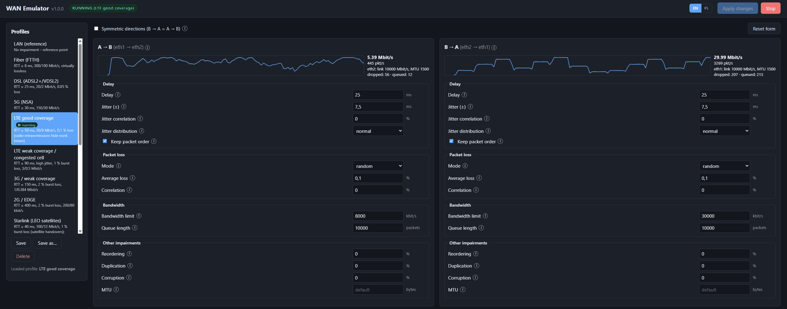

# Emulator WAN

[](https://github.com/Maku-hub/wan-emulator/actions/workflows/ci.yml)
[](LICENSE)
[](#wymagania)
[](https://www.python.org/downloads/)
[](https://github.com/Maku-hub/wan-emulator/releases)

[English version](README.md)

Emulator łącza WAN dla Linuksa z panelem WWW. Komputer wpięty między dwa urządzenia jako przezroczysty most dodaje opóźnienie, jitter, straty pakietów, ograniczenie przepustowości i inne zakłócenia, osobno dla każdego kierunku. Emulację wykonuje mechanizm jądra `tc` / netem; panel stosuje ustawienia, pokazuje statystyki na żywo i udostępnia REST API.



## Funkcje

- Opóźnienie i jitter, straty losowe lub seriami, limit przepustowości, zmiana kolejności, duplikacja, uszkodzenia, limit MTU
- Osobne ustawienia dla każdego kierunku
- Nazwane profile, w tym 16 typowych łączy (DSL, LTE, 3G, Starlink, satelita GEO, VPN, ...)
- Statystyki przepustowości i odrzuconych pakietów na żywo
- REST API do automatyzacji testów
- Interfejs po angielsku i po polsku

## Zasada działania

```
 [Urządzenie A] -- eth1 +---------------------------+ eth2 -- [Urządzenie B]
                        |  most Linux br0 + netem   |
                        +-------------+-------------+
                                      | eth0: zarządzanie (SSH, panel WWW)
```

- Komputer działa jak przełącznik z dwoma portami: urządzenia po obu stronach są w tej samej sieci i nie wymagają dodatkowej konfiguracji.
- netem działa na ruchu wychodzącym, więc **A → B** jest ustawiane na `eth2`, a **B → A** na `eth1`.
- Emulacja obejmuje cały ruch przez most, także ARP.

Nazwy interfejsów i adresy w tym dokumencie są przykładowe, patrz [Konfiguracja](#konfiguracja).

## Wymagania

- Komputer z trzema portami Ethernet (dwa porty mostu, jeden zarządzający)
- Debian 13; inne dystrybucje z systemd mogą wymagać drobnych zmian w skryptach instalacyjnych

## Instalacja

1. Zainstaluj Debian 13 z serwerem SSH i podłącz port zarządzający do sieci z dostępem do Internetu.
2. Skopiuj projekt na serwer i utwórz plik ustawień:

   ```bash
   cp config/wanemu.conf.example config/wanemu.conf
   nano config/wanemu.conf        # nazwy interfejsów (ip -br link) i adres zarządzający
   ```

3. Wykonaj na serwerze:

   ```bash
   sudo ./scripts/install_packages.sh        # pakiety, wymaga Internetu
   sudo ./scripts/install_app.sh             # panel WWW i profile domyślne
   sudo python3 -B tests/netns_selftest.py   # sprawdzenie działania netem
   sudo ./scripts/setup_network.sh           # most i adres zarządzający
   ```

4. Otwórz `http://<adres-zarządzający>:8080`.

Bez `MGMT_GATEWAY` serwer po kroku 3 nie ma dostępu do Internetu. Gdy będzie potrzebny, ustaw bramę (lub DHCP) w `config/wanemu.conf` i ponownie uruchom `setup_network.sh`.

## Konfiguracja

Wszystko, co zależy od serwera, jest w `config/wanemu.conf` (plik nieśledzony przez git). Skrypty generują z niego konfigurację sieci, ustawienia panelu i usługę systemd.

| Ustawienie | Przykład | Znaczenie |
|---|---|---|
| `PORT_A` | `eth1` | port mostu, strona A |
| `PORT_B` | `eth2` | port mostu, strona B |
| `BRIDGE` | `br0` | nazwa mostu |
| `MGMT_IF` | `eth0` | interfejs zarządzający |
| `MGMT_ADDRESS` | `192.168.100.1/24` | adres zarządzający, puste = DHCP |
| `MGMT_GATEWAY` | | opcjonalna brama domyślna |
| `PANEL_PORT` | `8080` | port panelu WWW |

`./scripts/setup_network.sh --print` pokazuje wygenerowane pliki sieciowe bez ich stosowania. Po zmianie portów uruchom ponownie `install_app.sh`, po zmianie ustawień sieci `setup_network.sh`.

## Użycie

1. Podłącz testowane urządzenia do portów strony A i strony B.
2. Otwórz panel, wczytaj profil albo ustaw parametry (ikonki „i” opisują każdy z nich).
3. Kliknij **Start**. Zmiany wprowadzone w trakcie działania zatwierdza przycisk **Zastosuj zmiany**.
4. **Stop** usuwa emulację.

Profile można w panelu zapisywać, nadpisywać i usuwać. Po restarcie serwera emulacja jest wyłączona. Panel nie ma logowania i jest przeznaczony do sieci laboratoryjnej.

## Profile domyślne

Strona A to klient, strona B to sieć (A → B to wysyłanie). RTT obejmuje oba kierunki. W API profile mają nazwy angielskie, polskie są tłumaczeniem w panelu.

| Profil | RTT | Jitter | Straty | Dół / góra |
|---|---|---|---|---|
| LAN (odniesienie) | 1 ms | - | - | bez limitu |
| Światłowód (FTTH) | 8 ms | 1 ms | - | 300 / 100 Mbit/s |
| DSL (ADSL2+/VDSL2) | 25 ms | 2,5 ms | 0,05 % | 20 / 2 Mbit/s |
| 5G (NSA) | 30 ms | 5 ms | 0,05 % | 150 / 30 Mbit/s |
| LTE dobry zasięg | 50 ms | 7,5 ms | 0,1 % | 30 / 8 Mbit/s |
| LTE słaby zasięg / przeciążona komórka | 90 ms | 30 ms | 1 % seriami | 3 / 0,5 Mbit/s |
| 3G / słaby zasięg | 150 ms | 25 ms | 2 % seriami | 1 / 0,384 Mbit/s |
| 2G / EDGE | 400 ms | 50 ms | 2 % seriami | 200 / 80 kbit/s |
| Starlink (satelity LEO) | 40 ms | 8 ms | 1 % seriami | 100 / 12 Mbit/s |
| Satelita GEO | 600 ms | 10 ms | 0,5 % | 20 / 3 Mbit/s |
| Łącze radiowe wąskopasmowe | 300 ms | 50 ms | 5 % seriami | 64 / 64 kbit/s |
| Wi-Fi zatłoczone | 30 ms | 10 ms | 1,5 % seriami | 20 / 20 Mbit/s |
| Łącze międzykontynentalne | 180 ms | 3 ms | 0,2 % | bez limitu |
| VPN / tunel (MTU 1400) | 40 ms | 3 ms | 0,1 % | bez limitu |
| Przeciążone łącze | 100 ms | 40 ms | 3 % | 512 / 512 kbit/s |
| Całkowita przerwa łącza | - | - | 100 % | - |

Profile generuje `scripts/generate_profiles.py`. `install_app.sh` nie nadpisuje istniejących profili; `--update-profiles` podmienia profile domyślne.

## REST API

| Metoda i ścieżka | Opis |
|---|---|
| `GET /api/status` | bieżący stan i konfiguracja |
| `GET /api/stats` | liczniki interfejsów i netem |
| `POST /api/start` | start lub zmiana: `{"config": {"a_to_b": {...}, "b_to_a": {...}}, "profile": "nazwa"}` |
| `POST /api/stop` | zatrzymanie |
| `POST /api/preview` | polecenia `tc` dla konfiguracji, bez wykonywania |
| `GET`, `PUT`, `DELETE /api/profiles/{nazwa}` | odczyt, zapis, usunięcie profilu (`GET /api/profiles` zwraca listę) |

Parametry kierunku (pominięte pola przyjmują te wartości):

```json
{
  "delay_ms": 0, "jitter_ms": 0, "jitter_correlation_pct": 0, "distribution": "none", "keep_order": false,
  "loss_mode": "none", "loss_pct": 0, "loss_correlation_pct": 0, "loss_burst_len": 5,
  "rate_kbit": 0, "limit": 10000,
  "reorder_pct": 0, "reorder_correlation_pct": 0, "duplicate_pct": 0, "corrupt_pct": 0,
  "mtu": null
}
```

`distribution`: `none`, `normal`, `pareto`, `paretonormal`. `loss_mode`: `none`, `random`, `burst`.

```bash
EMU=http://192.168.100.1:8080
curl -X POST $EMU/api/start -H 'Content-Type: application/json' \
     -d '{"config": {"a_to_b": {"delay_ms": 100, "loss_mode": "random", "loss_pct": 2}}}'
curl -X POST $EMU/api/stop
```

## Rozwój

```
app/wanemu/     aplikacja FastAPI, strona w static/ (teksty interfejsu w i18n.js)
config/         przykład ustawień i pliki instalowane na serwerze
profiles/       profile domyślne (generowane)
scripts/        instalacja, konfiguracja sieci, wdrożenie, generator profili
tests/          testy
```

| Test | Wymagania |
|---|---|
| `pytest` | brak |
| `node tests/check_i18n.js` | Node.js |
| `sudo python3 -B tests/netns_selftest.py` | Linux, root, iperf3; prawdziwy netem na network namespaces |
| `python3 -B tests/api_smoketest.py` | serwer emulatora; uruchamia każdy profil na portach mostu |

GitHub Actions uruchamia ruff, shellcheck, powyższe testy (bez smoke testu) i sprawdza zgodność `profiles/` z generatorem.

`scripts/deploy.sh <host-ssh>` kopiuje katalog roboczy do `~/emulator_wan` na serwerze.

## Rozwiązywanie problemów

| Problem | Co sprawdzić |
|---|---|
| Panel nie odpowiada | `systemctl status wanemu`, `journalctl -u wanemu` |
| A i B się nie widzą | stan linku w panelu, `bridge link`, ustawione 100 % strat lub małe MTU |
| Wyniki odbiegają od ustawień | rosnący licznik odrzuconych: za krótka kolejka lub za niski limit przepustowości |
| Wyłączenie emulacji bez panelu | `sudo tc qdisc del dev eth1 root; sudo tc qdisc del dev eth2 root` |

## Uwagi o netem

- Jitter zmienia kolejność pakietów. Kolejka `pfifo` pod netem nie zapobiega temu w nowszych jądrach, ustawienie `rate` tak, dlatego opcja „Zachowaj kolejność pakietów” dodaje `rate 100gbit`.
- `tc qdisc change` zostawia parametry, których nie podano. Panel zamiast tego usuwa i tworzy kolejkę od nowa, co gubi pakiety czekające w niej w tym momencie.
- Limit przepustowości liczy całe ramki Ethernet, więc przepustowość TCP to ok. 96 % limitu.
- Na moście pakiety większe niż MTU są odrzucane po cichu, bez ICMP.

## Plany

- Scenariusze czasowe (np. degradacja, przerwy, przełączanie satelitów)
- Reguły dla wybranych strumieni
- Przechwytywanie ruchu z poziomu panelu

## Licencja

MIT, patrz [LICENSE](LICENSE).
